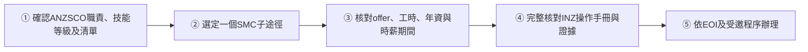

# 🇳🇿 新西兰 · New Zealand

   

**SMC 6 分制技术移民；投资移民 NZD 500 万起**

[🧑‍💻 技术移民 SMC](#nz-smc) · [💰 Active Investor Plus 投资移民](#nz-aip) · [📖 深度解读](#deep)

> [!NOTE]
> 本篇依据 2026-10 对政府页面和公开资料的检索整理，核查深度低于欧洲篇，递交前请回到官方入口核对。

> [!IMPORTANT]
> 🇹🇼 **臺灣護照讀者**：本頁沿用上游以**中國大陸護照與中國生活成本**為基準的敘述，不代表已完成臺灣護照個案資格審查。臺灣適用路線、官方來源及尚待核對範圍見 [臺灣專區](../taiwan/README.md)。

## 🏙️ 生活档案

<table>
<tr><td width="25%" valign="top">💶 生活成本指数（纽约=100） <b>60.2 ●●●○○（中国 30.7）</b></td><td width="25%" valign="top">🏠 房租指数（纽约=100） <b>24.6 ●●●●○（中国 9.5）</b></td><td width="25%" valign="top">🛡️ 安全指数 <b>51.2 ●●○○○（中国 77.0）</b></td><td width="25%" valign="top">🛂 护照免签目的地 <b>183 个（中国 81）</b></td></tr>
<tr><td width="25%" valign="top">技术移民 <b>6 分制</b></td><td width="25%" valign="top">投资 <b>NZD 500 万起</b></td><td width="25%" valign="top">父母 <b>Parent Boost 5 年签</b></td><td width="25%" valign="top">英语 <b>雅思约 6.5</b></td></tr>
</table>

数据：Numbeo 2026 年中、Henley Passport Index 2026。● 越多越好。

## 📊 路线速查

| 路线 | 类型 | 一句话 | 状态 |
|---|---|---|:-:|
| [技术移民 SMC](#nz-smc) | 🧑‍💻 技术工作 | 紐西蘭 SMC 依積分、技術工作經驗、技工／技術人員三分支研究；需具體ANZSCO、認可雇主、合格工時、年資與適用時薪。Red排除的是工作經驗子途徑而非全部SMC，Amber有較高NZ年資及薪資要求。 | 🟢 开放 |
| [Active Investor Plus 投资移民](#nz-aip) | 💰 投资居留 | 增长类 500 万投资 3 年、在新住 21 天即可永居。 | 🟢 开放 |

---

## 🧑‍💻 技术移民 SMC

 

> **紐西蘭 SMC 依積分、技術工作經驗、技工／技術人員三分支研究；需具體ANZSCO、認可雇主、合格工時、年資與適用時薪。Red排除的是工作經驗子途徑而非全部SMC，Amber有較高NZ年資及薪資要求。**

<table>
<tr><td width="33%" valign="top">年齡及工作 <b>申請時55歲或以下；合格認可雇主、職位、工時、期限、英語與其他條件</b></td><td width="33%" valign="top">積分路徑 <b>學歷／收入／職業註冊選一基本類別，再依規則加合格NZ經驗；不能三類基本分相加</b></td><td width="33%" valign="top">一般工作經驗路徑 <b>最近10年前段至少3年相關經驗，加額外最近4年內2年NZ skilled經驗；skill1–3、一般1.1倍適用SMC時薪，年資不得重複</b></td></tr>
<tr><td width="33%" valign="top">Amber List工作經驗 <b>前段3年相關經驗須在NZ，再加2年NZ skilled經驗；相應工作與歷史年資要達1.2倍</b></td><td width="33%" valign="top">Red List／skill4–5 <b>不能走Skilled Work Experience，不等於積分途徑也全部禁止</b></td><td width="33%" valign="top">技工／技術人員 <b>專屬職業清單、相關Level4以上資格；資格後2.5年前段經驗加1.5年NZ skilled經驗，後者在申請前三年；一般1倍適用基準</b></td></tr>
<tr><td width="33%" valign="top">薪資須按日期查表 <b>2026-03-09起基準NZD35，1.1倍38.50、1.2倍42；特定歷史基準依工簽／年資規則，不能全部用今天門檻</b></td><td width="33%" valign="top">核准身分 <b>Resident Visa與Permanent Resident Visa仍有程序及權利差異；EOI不是工作許可</b></td><td width="33%" valign="top"></td></tr>
</table>

### 🗺️ 申请流程

1. **確認ANZSCO職責、技能等級及清單** — 不依籠統的IT職稱推定
2. **選定一個SMC子途徑** — 紅黃清單限制不擴張到所有路徑
3. **核對offer、工時、年資與時薪期間** — 前後段不得重複，歷史時薪不能只看現在薪水
4. **完整核對INZ操作手冊與證據** — 本站不自行產生完整SMC官方分數
5. **依EOI及受邀程序辦理** — 核准Resident Visa後的後續身分另查

> [!WARNING]
> **注意**
> - 工作經驗與技工兩新路徑不計自雇；適用日期及歷史薪資要查官方。
> - Resident Visa並非自動Permanent Resident Visa。

[↑ 回到顶部](#top)

---

## 💰 Active Investor Plus 投资移民

 

> **增长类 500 万投资 3 年、在新住 21 天即可永居。**

<table>
<tr><td width="33%" valign="top">增长类 <b>NZD 5,000,000，3 年，21 天</b></td><td width="33%" valign="top">平衡类 <b>NZD 10,000,000，5 年，105 天</b></td><td width="33%" valign="top">英语 <b>2025 起不要求</b></td></tr>
<tr><td width="33%" valign="top">费用 <b>NZD 27,470 起</b></td><td width="33%" valign="top"></td><td width="33%" valign="top"></td></tr>
</table>

[↑ 回到顶部](#top)

---

## 📖 深度解读

### 主要路线

| 路线 | 要点 |
|---|---|
| **技术移民 SMC（Skilled Migrant Category）** | 申請時55歲或以下，合格認可雇主及職位。2026-08-24後分積分、技術工作經驗、技工／技術人員；Red／Amber限制只套正確分支，年資與時薪按官方日期核對。詳見下方2026-11-07欄位核查。 |
| 绿色清单（Green List） | 紧缺职业可直通或工作 2 年后申请居留 |
| **Active Investor Plus 投资移民** | 增长类 ≥ **NZD 500 万**（持有 3 年，在新最少 21 天）；平衡类 ≥ NZD 1,000 万（5 年，105 天）；2025-04 起取消英语要求；政府费用 NZD 27,470 起 |
| Parent Boost 父母签证 | 2025-09 开放，5 年多次入境，可再续 5 年，**不通居留** |
| 父母退休居留 | 投资 NZD 100 万 × 4 年 + 生活资金和收入要求 |

### 官方入口

- [Immigration New Zealand](https://www.immigration.govt.nz/)

### 2026-11-07 台灣版問卷核查

網站已分開三條SMC子途徑、實際ANZSCO與技能等級、Red／Amber、非重複年資、合格歷史薪資與日期；未確認不算符合。完整來源：[本輪核查](../taiwan/eligibility-update-2026-11-07.md)。這不是完整個案法律判斷，其他本頁上游政策未全面重查。

## 🔗 官方入口

- [Immigration NZ](https://www.immigration.govt.nz/)

[← 🇦🇺 澳大利亚](australia.md) ｜ [🌏 主要移民地区](README.md) ｜ [🏠 首页](../../README.md) ｜ [🇯🇵 日本 →](japan.md)

